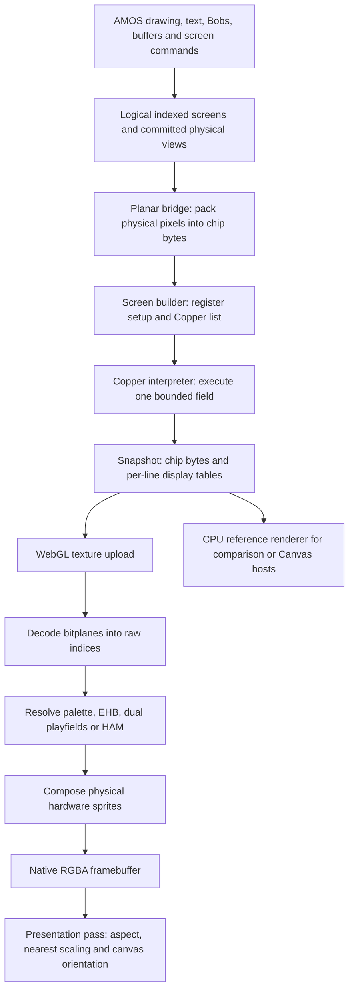

# How the AMOScript WebGL renderer works

This guide explains the display pipeline from AMOS drawing to browser pixels.
It describes the implemented renderer, rather than a complete Amiga chipset
emulator. For exact interfaces and bounds, see the linked contracts and source
files. The code described here includes the WebGL HAM6 implementation.

## 1. The basic idea: a picture made of bits and a colour table

An ordinary browser image stores a colour for every pixel. An Amiga-style
**planar** image instead stores several monochrome images called **bitplanes**.
Each plane contributes one bit to a pixel's colour index. A palette translates
that index into an RGB colour.

With three planes, each pixel has three bits and can select eight colours:

```text
                         pixel 0   pixel 1   pixel 2   pixel 3
Plane 1, weight 1             1         0         1         0
Plane 2, weight 2             0         1         1         0
Plane 3, weight 4             1         0         0         0
                             ─         ─         ─         ─
Palette index                5         2         3         0
Displayed colour       palette[5] palette[2] palette[3] palette[0]
```

The palette is small: OCS/ECS colour registers hold four bits each for red,
green and blue. `$A3F`, for example, becomes `[170, 51, 255]` in the browser by
multiplying each component by 17. Changing a palette entry can therefore change
many displayed pixels without changing any bitmap bits.

This distinction also explains why a six-plane image is not always an ordinary
64-colour palette image. Six planes can encode Extra Half Brite or HAM commands;
the display mode determines how those six bits are interpreted.

## 2. The complete pipeline



There are three distinct kinds of state:

1. **AMOS state:** selected screen, drawing pixels, logical/physical buffers,
   Bobs, palettes, screen positions and offsets.
2. **Physical display state:** what the committed screen arrangement would
   display, represented as planar memory and register values for each raster line.
3. **Browser presentation state:** canvas size, fullscreen, scaling and input.

Selecting an AMOS screen chooses a drawing destination; it does not necessarily
bring that screen to the front. `Auto View Off` and `View` can stage and commit
presentation changes separately from drawing.

The current runtime still owns most drawing in indexed arrays. The planar
bridge packs those pixels into a physical chip-memory image. This is a real
planar input to the GPU, but it is not yet a design where every AMOS drawing
operation directly edits authoritative chip bitplanes. That storage migration
is a separate architectural task.

The GPU does not run AMOS instructions or execute the Copper list. Those are
CPU responsibilities. It receives the resulting display snapshot and performs
the bitplane decoding and colour composition itself. CPU reference colours are
not uploaded as the GPU's picture.

Source: [AMOS display](../lib/amos/display.js),
[Copper builder](../lib/display/copper/builder.js),
[interpreter](../lib/display/copper/interpreter.js),
[WebGL renderer](../lib/display/webgl/renderer.js).

## 3. The snapshot and its GPU representation

A snapshot consists of a chip-memory byte image plus a versioned `FrameState`.
Supported chip images contain 512 KiB, 1 MiB or 2 MiB. Metadata specifies the
native output width, field-line count, sampling grid, pixel aspect, video rate,
origin and optional interlace field.

The important point is that registers and palettes are stored **per line**.
The shader does not assume a single resolution, palette or plane address for
the whole picture.

| Texture | Format | Meaning |
| --- | --- | --- |
| `chip` | R8UI | Raw chip bytes; 2,048 bytes per texture row |
| `lineRegs` | R32UI | 32 register/state values for each output line |
| `linePal` | RGBA8 | 256 palette slots per line; current OCS/ECS rendering uses the first 32 |
| `lineSprites` | RGBA32UI | Eight physical sprite-channel records per line |
| `lineEvents` and overflow tables | Integer textures | Retained mid-line register events; not yet accepted by the pixel renderer |
| `indexBuf` | R16UI | Decoded raw pixel index and inactive-window marker |
| `hamA`, `hamB` | R32UI | Optional HAM prefix-scan scratch targets |
| `colourBuf` | RGBA8 | Resolved native pixels, including sprites |

`lineRegs` contains eight plane pointers, BPLCON0/1/2, reserved extended-mode slots,
horizontal window bounds, a signed source fetch offset, DMA flags and event
count. Modulos have already been applied by the interpreter when it produces the
per-line pointers; the GPU does not advance pointers between raster rows. See
the [snapshot ABI](display-snapshots.md) for column definitions.

Uploads use integer texels, nearest filtering and explicit typed arrays. Chip
words retain their big-endian byte encoding; numeric register tables upload as
numeric values. The GPU reads chip bytes with:

```text
texture column = address & 2047
texture row    = address >> 11
```

The resource owner retains its own snapshot copy. The first upload and every
context restoration upload all chip rows. Subsequent uploads compare 2,048-byte
rows and upload merged changed ranges; palettes and other tables still update.
This comparison currently scans chip bytes on the CPU. Palette-only changes can
avoid chip transfers, but this is not yet a revision-driven, zero-scan uploader.

See [GPU resources](webgl-resources.md) and
[resource implementation](../lib/display/webgl/resources.js).

## 4. The decode pass: finding one pixel's bits

For each native output sample `(x, line)`, the decode shader reads that line's
window, resolution, plane count and DMA state. Samples outside the display
window, or with the required playfield DMA disabled, receive an inactive marker.
They do not perform a visible bitplane fetch.

Inside the window, the source coordinate is:

```text
sourceX = floor((x - windowStart) / samplesPerSourcePixel)
```

On the ordinary OCS grid, a lowres pixel occupies two native samples and a hires
pixel occupies one. For each plane:

```text
sourceBit   = sourceX + fetchOffset - planeScrollDelay
byteAddress = planePointerForThisLine + floor(sourceBit / 8)
bitPosition = 7 - (sourceBit & 7)
bit         = (chip[byteAddress] >> bitPosition) & 1
index      |= bit << planeNumberStartingAtZero
```

Bits are read most significant first. Negative source bits contribute zero,
without reading before the plane pointer. Signed window origins preserve their
sampling phase when a view is clipped at the left edge.

Before drawing, JavaScript validates the snapshot and the maximum required
fetch address for each active plane/line. The shader is not allowed to turn
an invalid chip address into a clamped texture read that merely looks plausible.

This pass produces indices, not RGB. The distinction is useful for dual
playfields, EHB, HAM and sprite/playfield priority, which need the original bits.

Source: `decode` and `sourceIndex` in
[shaders.js](../lib/display/webgl/shaders.js).

## 5. Colour resolution: normal, EHB and HAM

### Ordinary indexed colours

The raw index selects a line-palette entry. Four lowres planes, for example,
select 16 colours. Hires currently supports at most four planes; ordinary
supported lowres modes use up to six, with six-plane non-HAM/non-DPF output
interpreted as EHB.

### Extra Half Brite

In EHB, the lower five index bits select one of 32 palette registers. Bit 5
requests half brightness. Each four-bit RGB component is shifted right before
expansion to eight bits:

```text
$135 → half-brite $012 → [0, 17, 34]
```

Halving already expanded eight-bit RGB would give different answers for odd
component values. The shader uses the four-bit operation.

### Hold And Modify

HAM6 uses its upper two bits as a command and its lower four as a value:

| Command | Operation |
| --- | --- |
| `00` | Replace RGB with palette entry 0–15 |
| `01` | Replace blue; retain red and green |
| `10` | Replace red; retain green and blue |
| `11` | Replace green; retain red and blue |

Every line starts from that line's COLOR00. Consequently, changing a command
near the left edge can affect colours far to its right. Cropping cannot simply
start decoding at the first visible pixel: preceding commands inside the window
must establish its colour history.

The GPU handles this with masked writes and a parallel inclusive prefix scan.
Each command is represented by an RGB12 value and the component bits it writes.
Two consecutive updates combine as:

```text
combined.mask  = earlier.mask | later.mask
combined.value = (earlier.value & ~later.mask) | later.value
```

This associative operation lets successive shader passes combine spans of
1, 2, 4, 8, ... preceding commands, using `hamA` and `hamB` alternately. The final
resolve applies the accumulated update to COLOR00. History remains independent
for each line. Duplication onto the native grid happens through lookup of the
resolved source command, not by advancing HAM twice per lowres pixel.

Five-plane HAM also works: the absent sixth bit means only palette and blue
commands occur. HAM history is bounded to 4,096 source commands per line,
including cropped prefixes, and must fit device texture limits. HAM8, hires HAM
and HAM combined with dual playfields are rejected.

A frame with active HAM uses `3 + ceil(log2(N))` render passes, where `N` is its
maximum source span: raw-index decode, HAM update decode, scan and resolve.
A one-command span takes three; 4,096 takes fifteen. Non-HAM frames retain two.
Presentation is a separate pass in both cases. These are pass counts, not
hardware timing measurements. See [GPU HAM](webgl-ham.md).

## 6. Dual playfields: two scrolling pictures from interleaved planes

Dual playfield mode interprets the same fetched bits as two independent
indices, rather than one large colour index:

```text
Hardware planes 1, 3, 5 → PF1 bits 0, 1, 2
Hardware planes 2, 4, 6 → PF2 bits 0, 1, 2
```

For raw bits `b0` through `b5`:

```text
PF1 = b0 + 2*b2 + 4*b4
PF2 = b1 + 2*b3 + 4*b5
```

Each playfield has up to three planes: seven visible colours plus transparent
index zero. PF1 selects palette entries 1–7; PF2 selects 9–15. If both indices
are zero, COLOR00 is displayed, rather than COLOR08.

BPLCON2's PF2PRI bit chooses which nonzero playfield wins where they overlap.
For example, PF1=3 and PF2=5 produce palette entry 3 when PF1 is in front, or
entry 13 when PF2 is in front. A zero foreground index always exposes the other
playfield. This is index transparency, not alpha blending.

The two lanes have separate plane pointers and separate BPLCON1 delay nibbles.
They can therefore scroll independently while sharing a display window and
palette-register set. In the AMOS pair, the first screen owns all 32 palette
registers; the second screen's standalone palette is not a second GPU palette.
Sprites also test the two playfields' priority masks
independently.

The AMOS facade implements bounded `Dual Playfield first,second` pairing.
It requires distinct, unpaired lowres screens of equal bitmap width, neither
HAM nor clones, with at most three planes each. The first screen must have the
same plane count as the second or one extra plane. The first owns presentation;
the second remains a logical drawing surface and is hidden as a separate view.
The bridge interleaves the two sources and retains their independent offsets.

Raw snapshot/builder PF2PRI support does not imply that every AMOS `Dual Priority`
syntax is implemented. That command is not currently an entry in DisplayTable.

Source: [display command table](../lib/DisplayTable.js),
[`dualPlayfield`](../lib/amos/display.js),
[mode contract](display-modes.md#dual-playfields).

## 7. Scrolling: moving the view without moving the bitmap

A screen bitmap can be larger than its visible window. Scrolling changes which
part is fetched, instead of copying the whole image every frame.

**Vertical scrolling** changes the starting source row and thus plane pointers.
**Coarse horizontal scrolling** advances pointers by whole words. **Fine
horizontal scrolling** changes BPLCON1's delays. Its low nibble controls hardware
planes 1/3/5 and its upper nibble controls 2/4/6. A delay unit is lowres-sized:
hires doubles the source-pixel delay so the physical shift stays consistent.

Fine scrolling needs extra fetched data at the left edge. The builder schedules
an earlier DDF start and the bridge provides the required prefix. The snapshot's
signed fetch offset and scroll delay then select the right source bits. Pointer
advance, fetched size and row modulo must agree; changing just the scroll
nibble would otherwise leave gaps or misalign the next row.

A modulo is the extra address adjustment after a line's fetched bytes. For
example, an 80-byte bitmap stride with a 40-byte fetch needs an additional
40-byte advance. The interpreter handles actual fetched size, signed modulos
and pointer latching; the shader receives the resulting pointer for each line.

`Screen Display` changes where/how much of the bitmap is visible. `Screen Offset`
changes its source region. `View` controls when staged geometry/offsets become
presentation state. None of these imply changing logical bitmap dimensions.

The raw GPU supports validated odd/even delays and signed fetch offsets.
The AMOS window facade remains more constrained: in particular, HAM fine window
scrolling and some off-field/placement forms remain gated. A renderer capability
does not automatically enable every AMOS geometry command.

See [window contract](screen-windows.md),
[horizontal placement](horizontal-placement.md) and
[scrolling details](display-modes.md#bitplane-scroll-and-fetch-alignment).

## 8. Lowres and hires in one split-screen display

Resolution is a property of each line's register state. It is not a property
of the browser canvas as a whole.

On a two-sample OCS grid:

| Band | Logical bitmap width | Native samples across | Source pixels per 16 native samples |
| --- | --- | --- | --- |
| Lowres game | 320 | 640 | 8 |
| Hires text panel | 640 | 640 | 16 |

The canvas can therefore contain a lowres playfield above a hires status panel.
Both occupy the same physical width. The shader reads each line's BPLCON0 and
chooses the appropriate source-pixel sampling rate. The rows can also have
different palettes, plane counts, pointers and scrolling settings.

The Copper builder prepares the new band's registers before its visible fetch.
The interpreter publishes that change into the per-line tables. The GPU then
renders both bands in a single rectangular output; it does not resize the
canvas or paste a separately rendered text panel on top.

This distinction matters for overlaps. Supported vertical split screens do not
mean arbitrary overlapping mixed-resolution windows are supported. The AMOS
priority bridge currently resolves bounded **lowres** overlaps into vertical
slices, selecting an owner for each interval and resuming the background with
adjusted source pointers. It is not a general per-pixel desktop window compositor.
Mixed-hires overlaps, HAM priority slices and excessive transition budgets remain
outside that bounded path.

Changes in palette, pointers and mode take Copper instruction time in the model.
Transitions must fit before data fetch or use genuine blank setup rows. The
builder rejects an impossible transition instead of instantly changing all
registers through a hidden RGBA overlay. Supported horizontal placement and field
clipping are described in the [placement](horizontal-placement.md) and
[priority](screen-priority.md) contracts.

## 9. What the Copper implementation actually does

The Amiga Copper is a small display-oriented processor. Its WAIT instruction
can synchronize register writes to beam positions, without a CPU interrupt for
every change. In AMOScript it is modeled synchronously on the CPU while building
a snapshot. It is not driven by browser timers at individual beam positions.

### Implemented interpreter operations

| Operation/state | Implemented behavior |
| --- | --- |
| MOVE | Checked register write; modeled four-colour-clock instruction cost |
| WAIT | Masked horizontal/vertical beam comparison; four-clock read and two-clock wake-up |
| SKIP | Conditional skip of one whole instruction, with modeled four-clock cost |
| COP1LC/COP2LC and COPJMP1/2 | Checked list pointers and jumps |
| Terminator | `$FFFF,$FFFE` holds state for the remaining field |
| PAL counter wrap | Low eight vertical bits wrap at 256; the standard barrier sequence is modeled |
| DMA | Set/clear DMACON semantics and checked playfield fetch state |
| Bitplanes | Pointers, BPLCON0/1/2, DIWSTRT/DIWSTOP, DDFSTRT/DDFSTOP and signed BPL1MOD/BPL2MOD |
| Colours | COLOR00–31, including per-line palette snapshots |
| NOOP | Accepted no-effect register destination |
| Sprites | Bounded pointer streams and POS/CTL/DATA/DATB state for eight physical channels |
| Diagnostics | Instruction count, PC, beam context, final registers, event and sprite budgets |

WAIT/SKIP use masked beam comparisons, with vertical bit 7 always compared.
WAIT's blitter-finished condition uses an explicit completion-time input, not
a simulated background blitter. Unsupported or protected MOVE destinations
are errors, rather than ignored writes.

The beam model uses 312 PAL lines of 227 colour clocks, or 262 NTSC lines with
alternating 227/228 clocks. It uses nominal 50/60 field rates. A caller may supply
a bounded blitter-busy completion time for WAIT conditions; this does not add a
cycle-accurate blitter or bus arbiter.

At data-fetch start, the interpreter latches plane bases and validates the
fetched region. At completion, it advances them by fetched bytes plus the signed
modulo. Supported pointer rewrites after completion affect the next line.
Unsupported configuration changes during an active fetch reject.

The screen builder generates the lists needed for supported screen bands,
priority slices and AMOS rainbow palette rows. It avoids redundant writes,
rewrites pointers advanced by DMA, and budgets setup against capture/fetch
positions. It is more restricted than the raw interpreter. General user-facing
AMOS Copper commands are not thereby implemented.

### Mid-line events: retained, not rendered

The interpreter can record ordered `(nativeX, register, value)` changes within
a line, including complete overflow streams. The ABI has storage for them.
However, the CPU reference and GPU renderer reject event-bearing lines rather
than pretending a single palette/register snapshot correctly represents them.

This does not prevent palettes changing **between** rows, rainbows, or split
screens. Those use the per-line state already described. Within this project's
bounded ordinary AMOS display target, mid-line palette rendering is not a
prerequisite for those effects. Its absence primarily limits more general raw
Copper display emulation and future custom hardware effects.

### Timing and geometry limits

Default budgets are 65,536 instructions, 32 fast events per line and 65,536 total
retained events; sprite DMA has a separate 16,384-word bound. Supported chip
register destinations, list addresses and fetches are checked explicitly.

Fixed instruction costs do not model all DMA bus contention, refresh slots,
fetch starvation, revision-specific latches or precise Amiga timing. The
interpreter is useful for deterministic display construction and validation;
it is not a hardware timing oracle. Likewise, source-derived/synthetic parity
tests are not emulator or Amiga captures.

See the [Copper contract](copper-display.md) for instruction semantics, bounds
and the distinction between builder, interpreter and renderer support.

## 10. Sprites versus Bobs

A Bob is drawn into the AMOS bitmap, with masking/background restoration as
required. Once packed by the bridge, its pixels are ordinary bitplane data.

Hardware sprites stay separate. The snapshot holds eight physical channels for
each line. The resolve shader reads their two-bit pixels, attached-pair flags
and priority registers. Attached pairs can form a four-bit sprite. It selects
the first nontransparent hardware pair before applying playfield masking; a
blocked pair does not reveal a later lower-priority sprite.

Sprite palette lookup and composition happen after playfield colour resolution.
For HAM, a sprite overlays the result without becoming part of the next HAM
pixel's colour history. `snapshotPlayfield()` intentionally excludes sprites;
`snapshotDisplay()` includes their physical records.

See [sprite display](sprite-display.md) for channel allocation, DMA reuse and
remaining contention/capture limits.

## 11. Browser presentation, ownership and failure behavior

`createRenderer(canvas)` exposes `render(snapshot)`, `present(options)`,
`readPixels()`, `clear()`, `dispose()` and diagnostics. A normal nonempty render
has two passes: decode and resolve. HAM adds the scan passes described above.
`present()` adds a separate draw from `colourBuf` to the canvas.

The presentation shader applies rational pixel aspect, nearest-neighbour scaling,
centering and optional letterboxing. Storage row zero is semantic top row;
presentation handles WebGL's canvas-coordinate orientation explicitly.
`readPixels()` reads the native offscreen colour target and is for tests/debug;
normal presentation does not read colours back to the CPU.

A live host can choose canvas dimensions on a rational aspect grid to avoid
internal letterboxing. Fullscreen scales that canvas with CSS, preserving its
bitmap/GPU buffer and input rectangle. The borderless fullscreen controls overlay
the display and do not reduce its rendering area. See [fullscreen](fullscreen.md).

The resource owner owns textures, shader programs, framebuffers and retained
snapshot bytes. It prevents render-target feedback, disables blending/dithering
for exact colour output, validates GL errors and deletes owned objects on disposal.

On context loss, rendering retains the latest valid snapshot and reports an
unavailable GPU backend. On restoration it rebuilds programs/textures, uploads
that snapshot, rerenders it and restores the last presentation request. HAM
scratch targets follow this lifetime and are released when no longer needed.
`clear()` forgets a removed display so restoration cannot resurrect it.

The browser harness may offer an explicit Canvas backend or handle construction
failure. CPU-rendered output is never counted as a successful GPU frame. Display
rendering and restoration do not advance the VM, its VBL clock or audio playback.

## 12. Evidence and practical reading order

The non-HAM renderer corpus checks 179 GPU/CPU frames, including independent
images, mode/scroll/sprite matrices and 100 seeded snapshots. The HAM demo adds
58 GPU comparisons plus validation and restoration checks, including independent
HAM image goldens. Additional original-game fixtures test the shared display
host; the limited ASM intro includes its actual HAM title on WebGL.

These are local Chromium/WebGL2 checks using SwiftShader, not physical GPU
performance measurements or native Amiga captures. The roadmap's hardware timing
budgets remain open.

Useful entry points:

- [Renderer API and parity contract](webgl-renderer.md).
- [GPU HAM design and bounds](webgl-ham.md).
- [Snapshot ABI](display-snapshots.md) and [GPU resource ownership](webgl-resources.md).
- [Physical screen builder and Copper interpreter](copper-display.md).
- [AMOS screen windows](screen-windows.md), [priority slices](screen-priority.md)
  and [horizontal placement](horizontal-placement.md).
- [Source shaders](../lib/display/webgl/shaders.js) and
  [renderer orchestration](../lib/display/webgl/renderer.js).
- [WebGL renderer demo](../demos/webgl-renderer.html) and
  [WebGL HAM demo](../demos/webgl-ham.html).
